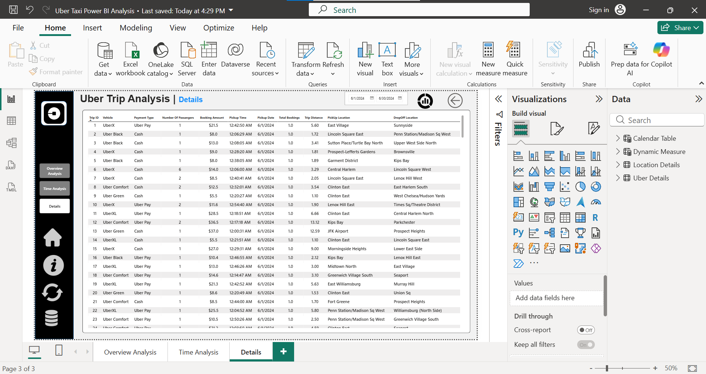

<div align="center">

# 🚕 Uber Trip Insights Dashboard using Power BI

An interactive report for exploring New York City trip demand, value, timing, vehicles, and locations.


**Muhammad Ali Nawaz**  
Power BI Developer / Data Analyst

</div>

---

## 📌 Project Overview

This Power BI report analyzes **103,728 trip records** from New York City for June 2024. It combines the supplied trip-detail and location workbooks into three report pages for reviewing booking activity, time patterns, vehicle/payment performance, and trip-level detail.

## 🎯 Analysis Objectives

- Summarize bookings, booking value, trip distance, and trip duration.
- Explore pickup activity by hour and weekday.
- Compare vehicle categories and payment types.
- Identify frequently used pickup/drop-off locations.
- Provide a trip-level details page for filtered inspection.

## 📊 Dataset Scope

| Data element | Supplied value |
| --- | ---: |
| Trip records | 103,728 |
| Unique Trip IDs | 103,728 |
| Location lookup rows | 265 |
| Booking value (fare plus surge) | $1,553,672.81 |
| Total trip distance | 348,933.81 miles |
| Average trip time | 15.86 minutes |
| Data period | June 1–30, 2024 |

These totals were recalculated from the included Excel workbooks. They describe only this supplied dataset, not Uber's complete operations.

## ✨ Report Pages

- **Overview Analysis:** Booking and distance KPIs, payment/day-night mix, vehicle comparison, location summaries, and booking value by date.
- **Time Analysis:** Pickup-time profile, weekday totals, and a day/hour heatmap.
- **Details:** Filterable trip-level rows with pickup/drop-off and payment information.

## 🖼️ Screenshots

| Overview Analysis | Time Analysis | Details |
| --- | --- | --- |
|  |  |  |

Screenshots show static report states. Open and refresh the PBIX in Power BI Desktop to validate the current report behavior.

## 🧰 Technology Stack

| Technology | Use in this project |
| --- | --- |
| Microsoft Power BI Desktop | Report pages, visuals, filters, navigation, and semantic model |
| Power Query | Excel source ingestion and preparation |
| DAX | KPI and report calculations |
| Microsoft Excel | Trip and location source workbooks |

## 📁 Project Structure

```text
Uber-Trip-Insights-Dashboard-using-Power-BI/
├── Dataset/
│   ├── Location Table.xlsx
│   └── Uber Trip Details.xlsx
├── dashboard/
│   └── Uber Taxi Power BI Analysis.pbix
├── Images/
│   ├── details.png
│   ├── overview analysis.png
│   └── time analysis.png
├── DATA_DICTIONARY.md
├── LICENSE
├── README.md
└── .gitignore
```

## 🚀 Open and Refresh the Report

1. Keep both workbooks together in the `Dataset` folder.
2. Open `dashboard/Uber Taxi Power BI Analysis.pbix` in Power BI Desktop.
3. If the project has moved, update the workbook folder source in **Transform data → Data source settings**.
4. Refresh the report and check all three pages, slicers, and the Details table.

## ✅ Validation Notes

- The Overview booking-value-by-date visual currently displays decade-level labels rather than the June 2024 daily dates. In Power BI Desktop, use `Calendar Table[Date]` at day level and verify the full-month and partial-month filters.
- Validate all relationships, visual field references, slicer propagation, and drill-through behavior in Model/Report view.
- The data contains two zero-duration trips and two trips over 100 miles (maximum 144.1 miles); these records are retained and documented in `DATA_DICTIONARY.md`.
- Location data includes one missing location label, two missing city values, repeated location names, and both `Bronx` and `The Bronx` labels.
- The PBIX contains the report/model artifact, but the full DAX formulas, M queries, and relationship settings are not supplied as separate readable source files.

## ⚠️ Data and Asset Attribution

The archive does not establish authoritative provenance or redistribution permission for the supplied dataset, logo, and other third-party assets. The MIT license covers original project materials by the author listed below; it does not grant rights to third-party data, trademarks, or assets. Confirm applicable terms before public redistribution.

## 👤 Author

**Muhammad Ali Nawaz**  
Power BI Developer / Data Analyst

## 📄 License

This project is released under the [MIT License](LICENSE) for original project materials. Third-party datasets, trademarks, logos, icons, and other external assets remain subject to their respective terms.
